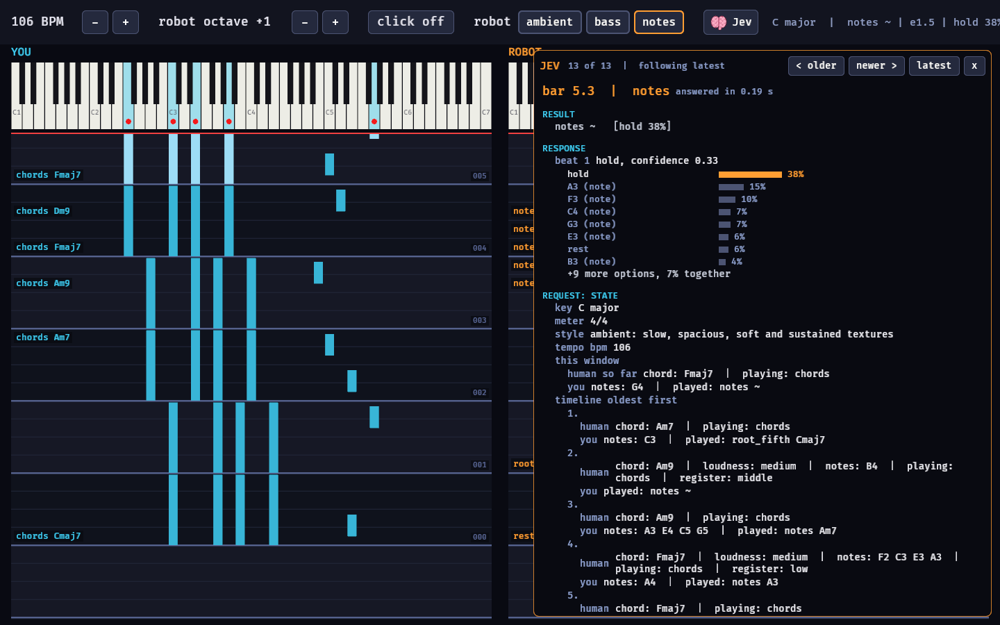

# jamsesh: a MIDI jammer driven by Jev

You play a MIDI keyboard; a robot musician plays along on a second instrument. Both go to your DAW (Reaper) as MIDI. The robot's musical choices are made by [Jev](https://gist.github.com/pjburnhill/adf8d28efcad9df037bfdece178ef965), TypeSafe's decision model, via OpenRouter.

Jev doesn't generate music. It picks from options. So this program listens to you, works out the musical situation (chord, key, register, dynamics), builds a small menu of sensible things the robot could do next, asks Jev to choose, and turns the choice back into MIDI, all on a fixed-tempo beat grid.



For how this was built, what we learned about working with Jev, and the design decisions, see [`notes/`](notes/README.md).

## How it works

A Jev round-trip takes about 0.15–0.5 s, too slow to pick every note in real time. Instead Jev decides **once per step** (a bar by default, down to one beat) and deterministic code does the rest:

1. **Listen.** Keyboard notes are timestamped in beats. Code recognizes your chord, estimates the key (Krumhansl-Schmuckler), and notes register, dynamics and whether you're playing chords or melody.
2. **Ask.** About one Jev round-trip before the step ends, the program sends Jev a description of the last few steps of *both* parts side by side (your notes and chords, the robot's notes and patterns) plus a few typed questions whose options code has already filtered for what makes musical sense.
3. **Play.** Answers are sampled with `--temperature`, rendered into notes for the next step and scheduled. If Jev is late or fails, the robot carries on with what it was doing.

## The robot's parts

Pick one with `--part`, or switch live (GUI buttons or keys `1`/`2`/`3`; the switch lands on the next bar line).

| Part | Jev decides | Code does |
|---|---|---|
| `ambient` (default) | a role (pad, arpeggio, counter-melody, echo of your phrase, drone, rest), an energy level, and the chord when you're not playing chords | voicings, rhythms, staying out of your register, following your chords |
| `bass` | a pattern (held root, pulse, root–fifth, octaves, walking, syncopated riff, rest) and energy | the line itself on your chord (or Jev's chord), E1–D#2 |
| `notes` | **each beat's actual note or chord**, from concrete options: scale notes within a fifth of its last note (described as chord tone / colour and how far it moves), the key's chords with their voicings plus the chord you're holding, "hold", "rest" | offering the options and sounding the result; notes ring until replaced |

Notes mode decides one beat at a time by default, so each pick sees the previous one.

## Setup (Windows + Reaper)

Windows usually lets only one program open a MIDI input at a time, so jamsesh owns the keyboard and forwards your playing to Reaper along with the robot, all on one virtual port:

```
Keyboard ──USB──▶ jamsesh ──▶ virtual port "jamsesh" ──▶ Reaper
                               ch 1  your notes (thru)   → your instrument track
                               ch 2  the robot           → robot instrument track
                               ch 10 click (optional)    → any GM/drum track
```

1. Install loopMIDI (`winget install TobiasErichsen.loopMIDI`) and add a port named `jamsesh`.
2. Reaper → Preferences → Audio → MIDI Inputs: **disable your keyboard**, enable `jamsesh` (restart Reaper or "Reset all MIDI devices" if it isn't listed). Make sure `jamsesh` is **not** enabled under MIDI Outputs, or loopMIDI will detect a feedback loop and mute the port.
3. Your track: arm it, input **MIDI › jamsesh › Channel 1**, monitoring on. (Not "Virtual MIDI Keyboard"; that's Reaper's on-screen keyboard.)
4. Robot track: same, **Channel 2**. A pad suits `ambient`; a bass for `bass`.
5. Optional: a track on **Channel 10** for the click (GM woodblocks, notes 76/77).
6. Put `OPENROUTER_API_KEY=...` in `.env`.

## Running

```
cargo run --release -- ports                          # list MIDI ports
cargo run --release -- monitor jamsesh                # print what's on a port (routing check)
cargo run --release -- probe                          # test the Jev connection
cargo run --release -- jam --gui --bpm 70             # jam with the window
cargo run --release -- jam --bpm 70 --part bass       # terminal only
cargo run --release -- jam --gui --part notes --key "D minor"
```

There's a one-bar count-in (click), then play. The robot starts answering from bar 2.

### Controls

| | GUI | Key (terminal or window) |
|---|---|---|
| Tempo ±2 BPM | − / + | `+` / `-` |
| Robot octave ±1 (from its next step) | − / + | `]` / `[` |
| Robot part | ambient / bass / notes | `1` / `2` / `3` |
| Click on/off | click | `c` |
| Jev panel | brain button | `J` (window) |
| Per-beat log lines | | `b` (terminal) |
| Quit (releases all notes) | close window | `q` / Esc |

### The GUI (`--gui`)

- Your keyboard (blue) and the robot's (orange), C1–C7, with a red dot on each sounding key.
- Under each, a tracker-style roll scrolling downward: notes appear at the red "now" line as they're played; bars are separate shaded bands with numbers; each step is labelled with your chord and the robot's decision.
- The **Jev panel** (brain button) shows each request and response as readable fields, not JSON: the result, Jev's answers with probability bars (its pick in orange), the state we sent, and every question with its options. It follows the latest exchange; `< older` / `newer >` pause, `latest` resumes, the mouse wheel scrolls. The jam keeps playing while it's open.

### Options

| Option | Default | |
|---|---|---|
| `--bpm` | 70 | tempo (change live) |
| `--part` | ambient | `ambient`, `bass`, `notes` |
| `--step <beats>` | 1 bar (notes: 1 beat) | how often Jev decides: `1`, `2`, or whole bars |
| `--history <N>` | 8 | how many past steps of both parts Jev sees |
| `--temperature` | 0.5 | 0 = always Jev's top pick, 1 = sample its probabilities as given |
| `--variety` | 0.7 | discounts a role the more of the last 4 bars the robot spent on it (log shows `(Jev preferred X)` when this changed the pick) |
| `--octave` | 0 | starting robot octave shift (−3..3) |
| `--key "D minor"` | detected | lock the key instead of detecting it |
| `--click` | off | click throughout (always on for the count-in) |
| `--input` / `--output` | keyboard / `jamsesh` port | port name substrings; `--output none` = dry run |
| `--human-channel` / `--robot-channel` / `--click-channel` | 1 / 2 / 10 | |
| `--log-jev` | off | append every request/response to `jev_log.jsonl` |
| `--demo` | off | scripted human part, for testing without a keyboard |
| `--mock` | off | random decisions instead of Jev (no network) |
| `--bars <N>` | | stop after N bars |

Cost is small: a request is ~1,000–1,500 input tokens (≈ $0.00003–0.00006). Once a bar at 70 BPM is ~$0.02/hour; notes mode (every beat) ~$0.25/hour.

### Testing without hardware

`jam --demo --output none` plays a scripted human part, calls Jev and prints the decisions without sending MIDI anywhere. Add `--gui` to watch it. `cargo test` runs the unit tests (chord/key detection, sustain pedal, rendering, the Jev panel formatter).

## Code map

| File | What |
|---|---|
| `src/jev.rs` | Typed Jev client (noul / choice / score) for OpenRouter's `/api/alpha/decisions` |
| `src/theory.rs` | Keys, chords, chord detection, key estimation, voicings |
| `src/listener.rs` | Records your playing (incl. sustain pedal) and summarizes a step |
| `src/decide.rs` | Builds Jev's state and options for each part; turns answers into a decision |
| `src/render.rs` | Decision → timed note events (patterns, voicings, octave shift) |
| `src/jam.rs` | Clock, scheduler, step loop, part switching, keys/commands |
| `src/midi_io.rs` | Port selection, thru/robot/click output, `monitor` |
| `src/viz.rs` | State shared with the GUI, and GUI → jam commands |
| `src/gui.rs` | Bevy window: keyboards, roll, header controls |
| `src/brain.rs` | The Jev panel and its brain icon |
| `src/jev_view.rs` | Formats one request/response into readable lines |
