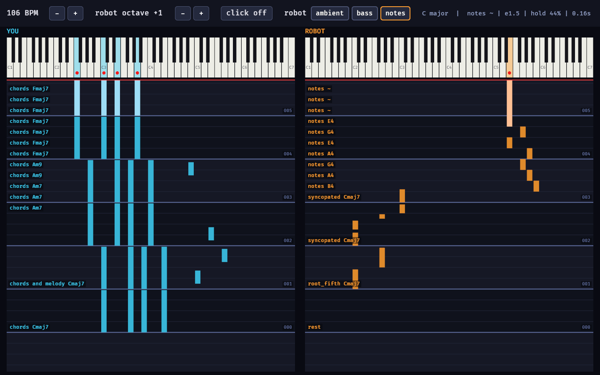
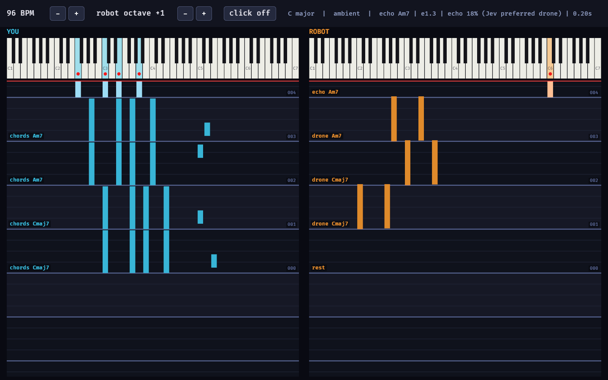

# Building jamsesh: notes

What we built, in what order, and what we learned along the way. Written 2026-09-18, at the end of the first build session.

- [How it was built](#how-it-was-built): the session, step by step
- [Working with Jev](jev.md): the API, how we framed questions, what moved its answers
- [Design decisions](design.md): timing, routing, the GUI, and why

## The brief

The starting README asked for a Rust program where a human plays a USB MIDI keyboard, the notes go to Jev (a "decision engine" on OpenRouter), Jev picks what to do next from options we give it, and the result is played on a second MIDI instrument so the robot jams along.

## How it was built

1. **Understanding Jev.** The linked gist is conceptual: Jev takes *state* plus typed *questions* (noul = yes/no probability, choice = pick an option, score = place on a scale) and returns probabilities, never free text. The user supplied the OpenRouter request format. A `probe` command confirmed the real response shape, including full probability distributions and confidence. See [jev.md](jev.md).

2. **Plan, agreed before coding.** Key constraint: a Jev call takes ~0.5 s cold and ~0.2 s warm, so Jev can't pick individual notes in real time. Jev decides once per bar; code handles timing and turns decisions into notes. The user chose: fixed BPM (adjustable), Reaper as the DAW for both instruments, ambient style.

3. **First working version.** Modules for theory (chord recognition, key estimation, voicings), listening, deciding, rendering and a beat-grid scheduler. A `--demo` scripted human and `--output none` dry run let us test end to end against real Jev without hardware. First runs surfaced two problems we fixed: the key flipping to E minor because a Cmaj7 voicing contains an Em triad (now it needs 3 bars of evidence, with slower decay and hysteresis), and Jev choosing `rest` too often (our own style text said "silence is welcome").

4. **Getting sound into Reaper.** Windows only lets one program open a MIDI input, so jamsesh owns the keyboard and forwards it. Everything goes out on one loopMIDI port, separated by channel (you ch 1, robot ch 2, click ch 10). We added a `monitor` command to prove the program's output was correct. The remaining confusion was Reaper-side: "Virtual MIDI Keyboard" is Reaper's on-screen keyboard, not the loopMIDI port, and the channel is chosen per track under the device.

5. **Faster decisions, more context.** `--step` lets Jev decide every half bar or every beat (requests are timed from measured latency), and `--history` controls how much Jev sees. Sustained parts only re-strike when the decision changes, so faster decisions sound more responsive rather than choppier. Added a per-beat log line.

6. **Bass mode.** The robot as bass player: Jev picks a pattern, code plays it on the right chord. Jev picked "pulse" almost every bar, and the cause was our own instruction text, which said "gives the music a *pulse*" next to an option named `pulse`. Rewording fixed it (pulse fell from ~70% to ~4%). We also added a code-side `--variety` control that discounts a role the more of the last four bars it has already had, applied *after* temperature so sharpening can't undo it.

7. **Octave control.** `[` / `]` and `--octave` shift everything the robot plays; held pads re-strike in the new octave rather than getting stuck.

8. **The Bevy GUI.** Two keyboards with red dots on sounding keys, a tracker-style roll scrolling downward, shaded bars, step labels, and buttons for tempo, octave and click. Bevy owns the main thread, so the jam loop moved to a background thread and the GUI draws from a shared snapshot. We verified it with the app's own screenshots (an env-var hook), not by grabbing the desktop.

9. **Both parts' history, and notes mode.** Jev had been seeing your notes but only a summary of the robot's past. Now each request carries a timeline of both parts side by side, window by window, including the robot's actual notes. Then the new `notes` part: code offers concrete notes and chords, and Jev picks each beat's. Deciding one beat at a time lets each pick hear the previous one; picking four beats at once gave independent picks like "E4 E4 E4 C4".

10. **Live part switching.** Ambient / bass / notes buttons in the GUI (and `1`/`2`/`3`). The switch lands on a bar line; the step grid can change with it, so histories are keyed by beat position rather than step number, and in-flight Jev answers from the old part are discarded.

11. **The Jev panel.** A brain button opens a scrollable panel showing each request and response as readable fields (no braces or quotes): result, answers with probability bars, the state we sent, and every question with its options. The jam keeps playing while it's open.

## Verified vs. not yet

- **Verified:** Jev integration and every mode against the real API (dry runs with the scripted human), the MIDI output on the loopMIDI port (via `monitor`), the GUI (screenshots, including simulated button presses), and unit tests (`cargo test`: chord and key detection, sustain pedal, rendering, octave shift, notes-mode holds, the panel formatter).
- **Confirmed by the user:** routing into Reaper works, and jamming works in terminal mode.
- **Not yet tried by hand:** clicking the GUI buttons, scrolling the Jev panel, and bass/notes modes with the real keyboard.

## Ideas not built yet

- A second OS window for the Jev panel instead of an overlay.
- Letting you steer Jev live (e.g. "busier", "darker") as extra state.
- Following the human's tempo, or MIDI clock from Reaper, instead of a fixed BPM.
- Bass as one option inside the ambient mix, rather than a separate part.
